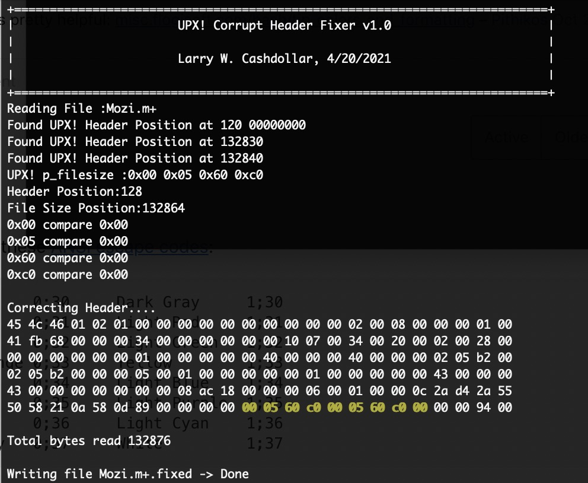

# UPX Fixer

Some C code to repair corrupt p_info header on UPX! packed malware.  It fixes two variants I found that were pretty common. There are many other variants
that have UPX headers either stripped, or null bytes injected to change offsets that this code does not work on.  

It also handles a third variant: junk bytes appended after the PackHeader.  `upx -d` only looks at the last ~8 KB of the file and expects the
32-byte PackHeader plus a 4-byte `overlay_offset` at the very end, so trailing junk (optionally with a decoy `UPX!` planted before the real
header) makes it fail with `header corrupted 1` although every header is intact.  `upx_dec` finds the real PackHeader (validated by UPX's
header checksum, so decoys are ignored), and writes `<file>.fixed` trimmed to end right after the `overlay_offset`.  Trailing zero bytes are
left alone, since UPX skips those itself.

```
$ make
make 	upx_dec	
make[1]: Entering directory '/home/larry/code/UPX'
gcc -Wall -ggdb -O2 -D DEBUG=0    -c -o upx_dec.o upx_dec.c
gcc -O2 -o upx_dec upx_dec.o
make[1]: Leaving directory '/home/larry/code/UPX'
```



